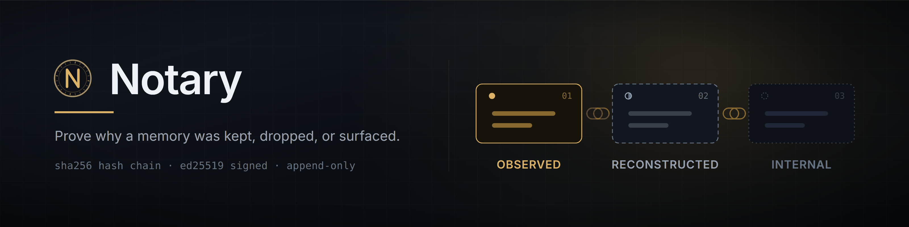
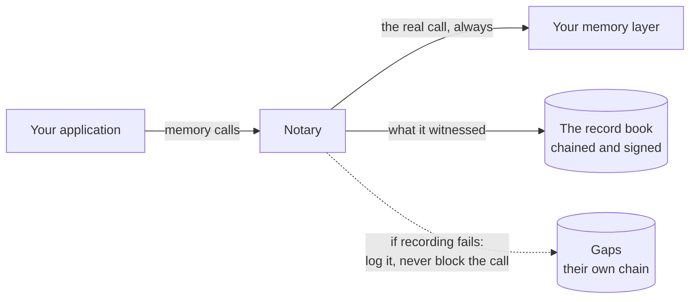

# Notary


**A signed, tamper-evident record of why your agent's memory kept, dropped, or surfaced something — kept so that someone who wasn't there can check it.**

---

## What this is

Your agent's memory layer stores things. It won't tell you why it *didn't* return something — and under
audit, "the model didn't return it" is not an answer anyone can accept.

Notary sits alongside your memory calls and writes down what it witnessed, in a record book that can be
checked offline and cannot be quietly altered. Where it can't know the answer, it says so instead of
guessing.

The rule underneath everything is this: **every entry records how much Notary actually knows.** Something
Notary watched happen is never presented with the same confidence as something it worked out — and a
decision your memory layer made privately is recorded as a decision with no explanation given, never
dressed up as a reason.

---

## The question it answers

Your incident review, your auditor, or a regulator asks: *"Why wasn't this memory returned?"* — or *"who
changed what, and when?"* Today the honest answer is usually *"we can't tell."*

With Notary you get one of three answers, and you can always tell which one you're getting:

| | |
|---|---|
| **Watched** | Notary saw it happen, and records where it saw it. |
| **Worked out** | Notary inferred it from something it recorded, and records the basis and the rule version. |
| **No reason given** | The memory layer decided internally and exposed nothing. Recorded as exactly that. |

None of these is a guess presented as a fact.

---

## What you can prove

**Nothing can be edited or deleted quietly.** Every entry is chained to the one before it and signed.
Change an entry, remove one, or cut off the end of the record book, and it is detectable — and the check
names the exact entry and the exact field that changed, not just "invalid".
*Evidence:* `notary verify`, and the chain-state page in the report.

**A retry cannot inflate or corrupt the record.** Re-running anything is a no-op. The trail cannot grow
duplicates, so a busy day or a retried job doesn't leave you explaining the numbers.

**Every entry states its own confidence, and that cannot be forged.** The three levels above are built by
three separate paths that accept different evidence — there is no path that lets one be recorded as
another. This isn't discipline or review; a build-time check refuses it.

**Your application never breaks because of the audit trail.** Auditing is never in the way. If the record
write fails, the memory call still completes as normal, and the failure is recorded in a separate log
with its own chain and reported loudly — so a failure to record is never silent.
*Evidence:* the gap log, and `notary gaps`.

**Sensitive content can be hidden without weakening the proof.** Content can be marked sensitive and
withheld from every reader while the fingerprints stay identical. Hiding something never changes what
was proven, and a reader can always tell "not shown" from "nothing was there".

**Key material is never printed.** Keys come from the environment, and every output path is redacted by
construction — with a test that asserts it.

---

## What it does not claim

A document with no stated limits is a document that hasn't been thought about, so:

- **It doesn't change what your agents remember.** Notary watches. It doesn't participate.
- **It cannot see inside your memory layer's reasoning.** When no reason is given, it records that no
  reason was given. It never invents one.
- **It blocks nothing.** Notary is evidence, not a control that prevents an action. This version has no
  enforcement function at all — it detects and records, and cannot stop anything.
- **It doesn't make your decisions compliant.** It makes them explainable and checkable.
- **It is not a certified product, and this page is not an attestation.** No audit of it has been
  performed, so nothing here should be read as one.
- **One capability is defined but not built.** A long-running in-process mode of the reconciler is
  reserved and explicitly refused at runtime: asking for it returns a clear error rather than doing
  nothing. The one-shot reconciler is what exists.

---

## The three levels of confidence

This is the idea everything else rests on, so here it is as a case.

A memory your agent stored last month isn't returned by a search today. Three very different things could
be true, and only one of them is anybody's fault:

| What Notary records | What it means |
|---|---|
| It was returned by an earlier search, and here is that search. | Watched. The memory was there. |
| It's missing from a complete listing of that scope. | Worked out. It was removed, inferred from an enumeration that proved its own completeness. |
| The history shows a delete with no reason attached. | No reason given. The decision was made internally and not explained. |

A reader can tell these apart at a glance, which is the whole point — the difference between "we removed
it deliberately" and "it vanished and we don't know why" is the difference between an answer and an
incident.

---

## Check it yourself, in about a minute

You don't need the memory layer, a network connection, or any keys. Just a Go toolchain:

```bash
bash scripts/demo.sh
```

It builds a small example record book through the real code paths, then walks it end to end — and shows
the two things the project exists for: an **edited entry caught and named**, and an **operation that was
never recorded reported as exactly that**.

It exits non-zero if any step fails, *including a step that was supposed to fail and didn't* — so a green
run means the demonstration actually demonstrated something.

---

## What an auditor receives

One command produces a **self-contained folder of ordinary web pages**: an overview, a page per memory, a
page per entry, and the full chain state.

It needs no server, no database and no software to read — it opens from a disk or an email attachment.
The folder travels as a whole, because the pages link to one another. Every page states plainly whether
the chain was verified, and whether anything sensitive was withheld. And if the record is broken, the
report is *still* written and says so — because a report of a tampered record book is exactly the artefact
its reader needs.

---

## Where it sits, and what happens when it fails



Two promises sit in that diagram:

1. **The memory call always completes.** A failure in the audit path cannot block, delay, or fail the
   call your application was actually making.
2. **A failure to record is never silent.** It goes into a separate log that has its own chain, so it
   can't be quietly erased, and it is reported loudly.

---

## Running it for real

Notary is a single command-line tool. It needs a signing key and a file of trusted public keys, and its
own `doctor` command will tell you what a given deployment is missing and the exact command that fixes
each finding — including generating the key pair, which needs no external tooling.

Every command, flag, environment variable and configuration rule is documented in
**[docs/OPERATIONS.md](docs/OPERATIONS.md)**.

---

## Reporting a vulnerability

Please report suspected security issues through this repository's
[private vulnerability reporting](https://github.com/ranscky/notary/security) — the **Report a
vulnerability** button on the Security tab — rather than a public issue, so a fix can be prepared before
the finding is disclosed. What's in scope, and what deliberately isn't, is in
[SECURITY.md](SECURITY.md).

---

## Status and licence

Complete and tested: the core record, the reconciler, and the `export`, `replay`, `explain`, `proxy`,
`serve`, `report` and `doctor` commands are all built, and the whole test suite passes — which is what the
badge at the top reports. What isn't built is listed, honestly, under *What it does not claim*.

The design record — every phase's plan and its design document — is in
[`docs/superpowers/`](docs/superpowers/).

Licensed under the **Apache License 2.0** — the full text is in [`LICENSE`](LICENSE).
Copyright 2026 Ransford Oduro.
