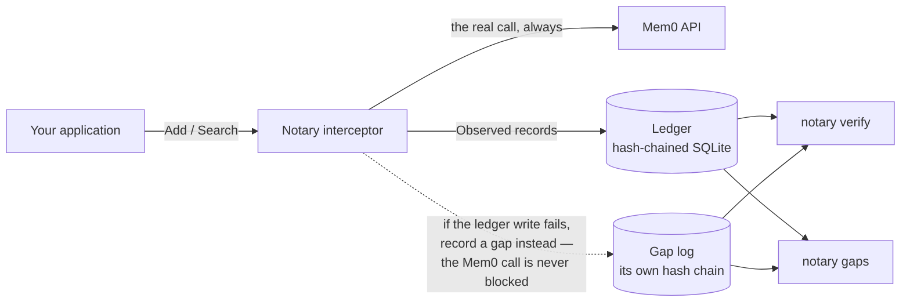

# Notary — operations reference

The [README](README.md) explains what Notary is, what it proves, and what it deliberately does not
claim. **This document is the manual**: what Notary is built from, how to run it, every command and
flag, the rules it applies to sensitive content, and the environment variables it reads.

Nothing here is intent — it describes the build in this repository.

---

## What it is built from

Go 1.25, one Cobra CLI, and an embedded SQLite store via `modernc.org/sqlite` — a **pure-Go** SQLite,
so **no cgo** and no C toolchain is needed to build it or to ship it. The module has **5 direct
dependencies**; signing uses only the standard library's `crypto/ed25519`. The dashboard is stdlib
`net/http` and `html/template`, with htmx vendored as an asset rather than a module, so serving it
adds no dependency.

---

## Build and run

```bash
go build ./...
go run ./cmd/notary version
```

`gaps` needs no configuration at all — it is read-only and requires no signing key:

```bash
go run ./cmd/notary gaps
```

---

## The commands

### `doctor` — what is wrong here, and how to fix it

`doctor` says what this deployment is missing and the exact command that fixes each finding: the ledger
and the gap log (opened for real, and created when absent, with the finding saying when this run is the
one that created them), the trusted keyring, the signing key (a warning rather than an error when it is
absent: most read paths need none, and `export` is the exception, refusing to start without one — even
with no `--checkpoint-out` — because it writes signed checkpoints), the Mem0 base URL, the Mem0 API key
(required only by the commands that call Mem0 — `reconcile` — since `proxy` forwards the caller's own
credential), the sensitivity rules when they are configured, and the ledger's chain state through the
same shared break collection `notary verify` uses, reported as **not checked** — never as broken — when
no trusted keys are configured. It exits non-zero when any finding is an error, so it can gate a
pipeline; warnings alone do not. `--out DIR` writes the same findings to `DIR/setup.html`.

**`--generate-key` is the only command that creates key material**, and no other command and no other
flag ever does (the demo script below mints its own throwaway key, from `/dev/urandom`, and never writes
it to disk). It prints a fresh ed25519 seed as an `export NOTARY_SIGNING_KEY=…` line to stdout and writes
no file; `--key-out PATH` writes that private half to a file instead (readable only by its owner — mode
`0600` on POSIX, an ACL naming only its owner, SYSTEM and Administrators on Windows — and refused inside
a checkout); and `--trusted-keys-out PATH`, with `--generate-key`, writes the matching **public** half
(mode `0644`, allowed inside a checkout, because a public half is not a credential) as the base64 line
`NOTARY_TRUSTED_KEYS_PATH` reads — so a first run needs no external tool to derive the public half from a
key it has just made. It requires `--generate-key` because a loaded signer exposes no public key to
recover, only its `KeyID` fingerprint and its `Sign` method. It needs no signing key and no Mem0 key to
run.

One call produces both halves of a fresh key pair — the private half printed as the `export` line to put
in the environment, and `--trusted-keys-out` writing the matching public half:

```bash
go run ./cmd/notary doctor                                  # what is wrong here, and how to fix it
go run ./cmd/notary doctor --generate-key --trusted-keys-out trusted-keys.txt
# prints:  export NOTARY_SIGNING_KEY=<base64 seed>    # the private half; nothing is written for it
# writes:  trusted-keys.txt (mode 0644)               # the public half, no external tool needed
```

### `verify` — walk the chain

`verify` needs a ledger and a keyring of trusted public keys (base64 ed25519 public keys, one per line —
the key ID is derived from the key, so the file can never disagree with itself). Within `verify`, a
signing key is needed only by `--write-checkpoint` and `--write-gap-checkpoint`, which sign a fresh
attestation; plain `verify`, `--checkpoint` and `--gap-checkpoint` read and check, and never sign:

```bash
export NOTARY_DB_PATH=notary.db
export NOTARY_TRUSTED_KEYS_PATH=trusted-keys.txt

go run ./cmd/notary verify                            # walk the chain
go run ./cmd/notary verify --write-checkpoint cp.json # attest the head
go run ./cmd/notary verify --checkpoint cp.json       # detect a removed tail
```

### `report` — the auditor's folder

`report` renders a slice of the ledger as a folder of static HTML pages: an index, one page per memory,
one per record, the chain state in full, and the stylesheet and filter script they link to. The slice is
bounded by construction — one subject, `--memory <mem0-id>` or `--from`/`--to` (bounded on each record's
event time) narrowed by the four scope flags, with no `--all` — and `--out` is required, refused when
the directory already holds files unless `--force` is given. Sensitive content is withheld by default and
the page says so; `--include-sensitive` prints it and changes no hash. It needs no signing key (it never
signs) and `--no-verify` needs no keyring at all — `verify.html` is still written, saying that no
verification ran, because a skipped check must never read as a clean one. Its chain state is `verify`'s
answer, through the same shared break collection, so the page and the command cannot disagree, and it
covers the whole ledger rather than the slice.

The ledger must already exist: `report` refuses a path with no ledger at it, or a zero-byte file, rather
than creating an empty one, because a report over nothing and a report over a mistyped path must never
look the same. It exits non-zero when the chain state it rendered is broken, **after** writing the pages,
because a report of a tampered ledger is exactly the artefact its reader needs. It does not check that
the file *is* a Notary ledger, and the code records why that belongs to a phase of its own: a file of
exactly one byte is initialised into an empty ledger — or, in the same way, a foreign SQLite file given
this project's schema — and renders 0 memories with exit 0.

The **evidence block** on every record page is not filtered by `--include-sensitive`: the flag governs
the record's stored content, the evidence is the record's own stored reason printed as the ledger hashed
it, and `reconcile` records whole upstream objects rather than curated fields — so such a reason can quote
memory text the sensitivity rules never marked. The index and every record page say so, and so does the
help text.

The folder travels as a whole: each page links the assets and its sibling pages relatively, so one page
lifted out of it renders unstyled and its links dangle.

```bash
export NOTARY_DB_PATH=notary.db
export NOTARY_TRUSTED_KEYS_PATH=trusted-keys.txt

go run ./cmd/notary report --out ./report --from 2026-09-01T00:00:00Z
go run ./cmd/notary report --out ./report --memory <mem0-id>
```

### `serve` — the local dashboard

`serve` serves the read-only ledger dashboard on the loopback address `127.0.0.1`, so a reviewer can read
the trail in a browser instead of a terminal: the same records `export`, `explain`, `gaps` and `verify`
report, rendered as pages. The records view defaults to the last 30 days and is narrowed by range and
scope in the page; each record opens its own page, each memory its lifecycle, and the gaps and
verification pages report what `notary gaps` and `notary verify` report. Sensitive content is withheld by
default and a per-view toggle reveals it for that view only, writing one audit line to stderr each time
and never changing a hash.

The routes are **`/` for the Overview** — the console's front page — **`/records` for the table** and
**`/asof` for the point-in-time view**, with `/record`, `/memory`, `/gaps` and `/verify` beside them. The
nav bar is one list in `internal/serve/nav.go` and is rendered by a template function, so a page added later
is one line there rather than an edit to every template.

`/asof` is the browser form of `notary replay`. It parses date, time and zone into a `replay.Request`,
runs the real `replay.Replayer` into a buffer, and decodes the JSONL it wrote back into `export.Line`s to
render the shared record table — so the inclusive boundary (`RecordedAt <= at`), the chain-prefix
verification, the scope conjunction and the redaction are all the package's, not the console's. The zone is
a required field with no default: a time without one is a different instant depending on where it is read,
so a missing zone is a validation message rather than an assumption about the server's or the browser's
locale. With no trusted keys configured the page runs nothing and says so in the Overview card's wording,
matching the CLI's refusal. The page shows how many records it displayed and its withheld count; it does
**not** show how many records were written after the instant, because `replay.Result` exposes `Records`,
`Redacted` and `Breaks` only, and a second read with a different boundary rule would be a second definition
of the same thing.

The Overview renders, in order: a three-state verdict card driven by the same `chainView` the banner uses
(`chainClean`, `chainNotVerified`, `chainBroken`), the ledger's count, span and per-tier split, and the
gap count from `ledger.OutstandingGaps` — the same read `notary gaps` reports. A ledger with **no** records
shows a first-run state instead of the figures, with a note that quotes the ledger path this console opened
(`Options.LedgerPath`) so it is specific to the deployment rather than generic advice; that note is the one
place in the console that names environment variables, and it is text for an engineer, not for the reviewer
who forwards it.

The Overview's figures come from `store.LedgerStats`, the one definition of "how many records and what
span" in the tree: the records view's own `extent()` delegates to it. It is two aggregate queries rather
than a row walk, because the front page shows those numbers on every load. A row whose stored tier is not
one of the three makes the read an error instead of producing a split that silently omits a record the
total counts.

`--port` is its only flag: it binds `127.0.0.1` and only `127.0.0.1` (there is no host or address flag)
and sets no CORS header, so a foreign page can neither reach nor read it. It is structurally read-only —
the ledger is opened with no signer, so it can never append — and it needs neither a signing key nor a
trusted-key file: a keyring, when one is configured, only enables the chain banner's verdict.

Every response carries a fixed set of security headers, set in one middleware (`securityHeaders` in
`internal/serve/security.go`) rather than per handler, so the refusals — the 405 and the 403 — carry them
as well as the pages: `Cache-Control: no-store`, because a page rendered with `reveal=1` must not outlive
the view in a browser cache or the session history; `X-Content-Type-Options: nosniff`; a
`Content-Security-Policy` of `default-src 'none'` that allows only the console's own script, stylesheet,
images and endpoints, pins `form-action` and `base-uri` to `'self'`, and sets `frame-ancestors 'none'` so
the dashboard cannot be framed; and `Referrer-Policy: no-referrer`, so a record or memory id does not
travel in a `Referer` header.

`connect-src 'self'` in that policy is what makes htmx work. Every `hx-get` — the reveal toggle and the
filter form — is a fetch, and a fetch is governed by `connect-src`, not by the `script-src` allowance
that let htmx load. Without it the browser blocks the request and the console quietly degrades to full
page reloads, with nothing visibly broken. A test derives the required directives from the embedded
markup, so adding an image, a font face or another request-bearing attribute fails until the policy names
it. htmx is configured through its `htmx-config` meta tag with eval, script-tag execution and
indicator-style injection switched off, which is what lets the policy carry neither `'unsafe-eval'` nor
`'unsafe-inline'`. The vendored htmx is pinned by `htmxSHA256` and `htmxSize` in
`internal/serve/embed.go`, and a test hashes the bytes the handler serves against them.

### `export` — a range as JSONL

`export` renders a range of the ledger to stdout as JSONL — one stable object per record — so an audit
can be diffed, grepped and reviewed. It is a read path: it never writes the ledger, and its only output
of its own is the optional checkpoint file.

```bash
export NOTARY_DB_PATH=notary.db
export NOTARY_SIGNING_KEY=<base64 ed25519 key>

go run ./cmd/notary export --from 2026-09-01T00:00:00Z
go run ./cmd/notary export --from 2026-09-01T00:00:00Z --checkpoint-out cp.json
go run ./cmd/notary verify --checkpoint cp.json    # verify the range the export covers
```

- **A signing key is required**, even when `--checkpoint-out` is not given. Like `reconcile`, `export`
  refuses to start without one rather than silently downgrade, so a keyless stdout-only export is not
  possible in v1.
- **Sensitive content is withheld by default.** A line whose stored content is marked sensitive carries
  the subject's `content_hash` and `"redacted":"sensitive"` instead of the text, so a reader can always
  tell "not shown" from "nothing was there". `--include-sensitive` prints the stored text instead; it
  changes only what is printed — never a hash, because rendering is a read path.
- **`--checkpoint-out <path>`** writes a signed head checkpoint in the exact format
  `verify --checkpoint` already reads, attesting the ledger head at export time (not the last record in
  the range), so a truncated tail is detectable later.
- **`--phrase` is opt-in** and adds an optional, display-only language-model paraphrase beside each
  record — never instead of it. It is off by default, so a provider is only billed for an export you
  asked for. It needs provider configuration from the environment: `NOTARY_PHRASE_MODEL` and
  `NOTARY_PHRASE_BASE_URL`, plus `NOTARY_PHRASE_API_KEY` for endpoints that need one. A phrasing
  failure never fails the export; it degrades to a note on stderr.
- **Scope flags** `--user-id`, `--agent-id`, `--app-id` and `--run-id` restrict the export to one
  entity scope and combine with AND, mirroring `reconcile`.
- **`--from` is required** and `--to` defaults to now. The range is bounded on each record's *event*
  time (`At`), not its write time (`RecordedAt`), so a record written late about an old event still
  belongs to that event's window.
- **`--max-span`** caps the range (default 366 days). The cost of an export scales with the range, so
  an over-long range is an error rather than an out-of-memory kill.

### `replay` — the ledger as it stood at one instant

`replay` streams the ledger as it stood at one instant to stdout as JSONL, one stable object per record,
byte-identical to an exported line: the records whose `RecordedAt` (the write time — the knowledge
instant — not the event time) is at or before the required `--at`, in Seq order, verified as a chain
prefix before they are written. The four scope flags restrict the replay to one entity scope, and an
unparseable `--at` is refused rather than silently treated as now. Sensitive content is withheld by
default and its line says so; `--include-sensitive` prints it and changes no hash. Because it verifies
rather than signs, it requires a trusted-key file and no signing key, and it reports any break in the
prefix on stderr and exits non-zero, leaving stdout as the JSONL stream it promised.

### `explain` — one record or one memory, in prose

`explain` answers one question about the ledger as prose: why a single record was written, or what
happened to a single memory over its life. The subject is one `<record-id>` argument or
`--memory <mem0-id>`, never both, and the memory view renders one line per record in Seq order, each line
carrying the record's event, reason kind, tier and **both of its instants** — when the event happened
(`At`) and when Notary wrote the claim (`RecordedAt`) — so a claim written long after the event it
describes can be seen as that.

`--json` prints the same records, in the same order, as one small JSON object instead of prose:
`{"records": [...]}`, each record carrying `seq`, `id`, `memory_id`, `event`, `reason_kind`, `tier`,
`at`, `recorded_at` and `sentence`, plus `content` only when the record carried content that was shown
and `redacted` only when content was withheld. Sensitive content is withheld by default and the view says
so; `--include-sensitive` prints it and changes no hash. It is a read path that signs and verifies
nothing, so it needs neither a signing key nor a trusted-key file.

### `reconcile` — the claims the ledger cannot observe

`reconcile` is a one-shot, schedulable pass that derives and records the claims the ledger cannot observe
directly: it polls Mem0 for unresolved adds, enumerates a scope to classify memories as kept or removed,
and reads recorded searches to classify a memory the search did not return as dropped. It is bounded by
`--since` (on each record's event time, not its write time) and the four scope flags, supports
`--dry-run`, and keys every derived claim on its subject and reason kind (the rule version, where a rule
justifies the inference) rather than on the run, so re-running it against an unchanged store appends
nothing. Every inference is named by a rule in a versioned registry.

`notary reconcile` is the first command to consume `NOTARY_MEM0_API_KEY`.

### `gaps` — the operations Notary could not witness

`gaps` reports the audit gaps: the operations where the ledger write itself failed. The gap log is
deliberately a **separate file with its own hash chain and its own signed checkpoints**, because it exists
for the case where the store is unavailable — sharing a store would defeat it.

Gap reconciliation as a library API (`AuditWriter.ReplayGaps`) has **no CLI**, because a gap entry records
which record is missing, not the record itself, so replay needs the caller's records.

### `proxy` — sit in front of Mem0

`proxy` serves Mem0 traffic and records the `add` and `search` requests that pass through it. The
application re-points its Mem0 base URL at Notary, which forwards every request to the real Mem0 and
returns the response untouched, recording the same records library mode records for those two endpoints
(the mode differences are noted under sensitivity rules below), with no code change in the application,
in any language. `get_all`, history, event-status and delete pass through unrecorded by design.

It needs a signing key (`NOTARY_SIGNING_KEY`, because ledger appends are signed), the upstream base URL
from `NOTARY_MEM0_BASE_URL`, and the ledger and gap log paths (`NOTARY_DB_PATH`, `NOTARY_GAP_LOG_PATH`);
its sensitivity rules come from `NOTARY_SENSITIVITY_RULES` with no flag. It needs **no** Mem0 API key —
it forwards the caller's own `Authorization` header and holds no credential of its own. Its flags are
`--addr`, `--queue-depth` and `--max-body`, and its stdout is unused: the listen banner and every drop
marker go to stderr.

---

## Sensitivity rules

Redaction follows content marked sensitive at **write** time. An application marks it either per call
(`library.Sensitive()`) or declaratively, by pointing `NOTARY_SENSITIVITY_RULES` at a YAML rules file:

```yaml
# Any rule that matches marks the record's content Sensitive at write time.
rules:
  - name: health-data
    match:
      scope:
        user_id: patient-42      # optional; omitted means any scope
      metadata:
        category: health         # matches a proxied add or a surfaced memory; see the note below
```

A rule matches when **every** clause it specifies matches, and a rule specifying neither clause is
rejected at load time. The rules file is read by the write paths — an application that constructs the
interceptor, and `notary proxy` — so there is no `export` flag for it: `export` writes no records.

One asymmetry matters when you write a rules file: **whether a `metadata:` clause can match an add
depends on the mode.** `library.Add`'s signature carries no metadata at all, so in library mode a rule
whose only clause is `metadata:` can never mark an add — only a `scope:` clause can. `notary proxy`
decodes each add's `metadata` from the request body, so the same rule CAN mark a proxied add. If the
content you mean to protect arrives through `library.Add`, match on `scope:`.

---

## Configuration

All configuration is environment-only:

| Variable | Purpose |
|---|---|
| `NOTARY_MEM0_API_KEY` | Mem0 API key |
| `NOTARY_MEM0_BASE_URL` | Mem0 base URL (default `https://api.mem0.ai`) |
| `NOTARY_DB_PATH` | ledger database (default `notary.db`) |
| `NOTARY_GAP_LOG_PATH` | gap log (default `notary-gaps.log`) |
| `NOTARY_SIGNING_KEY` | base64 ed25519 signing key — a 32-byte seed or a 64-byte private key. The key material goes **in** this variable; nothing reads an env var for its name. |
| `NOTARY_TRUSTED_KEYS_PATH` | file of trusted public keys |
| `NOTARY_SENSITIVITY_RULES` | path to a YAML sensitivity-rules file, read by the write paths (an application constructing an interceptor, and `notary proxy`); there is deliberately no CLI flag — see the export section |
| `NOTARY_PHRASE_BASE_URL` | OpenAI-compatible base URL for `--phrase` (required by `--phrase`) |
| `NOTARY_PHRASE_MODEL` | model name for `--phrase` (required by `--phrase`) |
| `NOTARY_PHRASE_API_KEY` | API key for `--phrase`; optional for endpoints that need none |

---

## What it records

| Event | When | Tier |
|---|---|---|
| `add_requested` | an add is acknowledged by Mem0 | `Observed` |
| `add_resolved` | the add's outcome is later polled | `Observed` |
| `search_performed` | a search runs (query, filters, `top_k`, `threshold`, result count) | `Observed` |
| `memory_surfaced` | one record per returned memory, with its score and rank | `Observed` |
| `memory_kept` | a memory is seen in a listing, or inferred by content match | `Observed` / `Reconstructed` |
| `memory_dropped` | a memory known to exist was not returned, or history shows a removal | `Reconstructed` / `Internal` |
| `audit_gap` | the audit trail itself failed | `Observed` |

---

## The mechanics, for the record

These are the implementations behind the properties the README states as outcomes.

**Tamper-evident chain.** Each record's hash covers its canonical bytes, its position, and its
predecessor's hash: `sha256("notary/record/v1" ‖ canonical ‖ uint64-BE seq ‖ prev-hash)`. Every
variable-length field is length-prefixed and every hash is domain-separated, so a field boundary cannot
be shifted to make two different records collide.

**Truncation detection.** A hash chain cannot see its own removed tail — what remains is
self-consistent. So `verify --write-checkpoint` emits a **signed head checkpoint**, and
`verify --checkpoint` fails loudly when the chain is shorter than the checkpoint attests. Plain `verify`
passes on a shortened chain by design; the checkpoint is what catches it.

**No replay between the two chains.** Signatures are ed25519, and a checkpoint is signed under a domain
tag — `notary/checkpoint/v1` for the ledger, `notary/gapcheckpoint/v1` for the gap log — so a checkpoint
that proves one chain's head cannot be presented as evidence about the other. `sign`'s cross-domain test
asserts exactly that: a gap checkpoint verified under the ledger's domain fails with
`ErrInvalidSignature`. Without the tag the two chains would share one signature space and the separation
would be decorative rather than real.

**Unforgeable tiers.** `Observed`, `Reconstructed` and `Internal` are built by **three separate
constructors that take disjoint evidence types**. There is no builder that accepts a tier as an argument,
so "record a guess as a fact" does not type-check. Negative-compile fixtures in `testdata/negative/` fail
the build if anyone tries — including forging a tier, building a `Reason` without a constructor, or
fabricating `Observed` evidence from nothing.

**Fail-open-loud.** An audit-write failure must never break the customer's application. The Mem0 call
always completes; the failure is recorded durably in the gap log and mirrored to a loud channel. The gap
log has its own chain, so a gap cannot be silently erased.

**Idempotent by construction.** Idempotency keys are deterministic and content-derived — never
wall-clock, never random. Re-appending an existing key is a no-op that returns the existing record, so
retries and re-runs cannot duplicate the trail.

**No secrets in output.** Keys come from the environment only, and key material is redacted by
construction on every rendering path — `%v`, `%+v`, `%#v` and `json.Marshal` included — with a canary
test asserting it.

**Architecture.** One hash chain, written by the interceptor on the request path and by the reconciler
off it. The gap log is a separate file with its own chain and its own signed checkpoints.



---

## Development

```bash
go build ./...     # builds clean
go vet ./...       # clean
gofmt -l .         # no output expected
go test ./...
```

`go test ./...` runs every package the `./...` pattern matches — which is nearly every package in the
tree, because `go build`, `go vet` and `go test` all skip `testdata` directories. The two programs that
live in one are built or run explicitly instead: `internal/ledger/testdata/crashwriter`, which the crash
test builds (`internal/ledger/crash_test.go`), and `testdata/demo/seed`, which `scripts/demo.sh` runs.
`internal/ledger` is the slow one (a subprocess crash test SIGKILLs a writer mid-transaction, ~30s), so a
full run takes a couple of minutes — run packages individually if you are on a short timeout.

Tests never touch the network. The Mem0 client is tested against **recorded response fixtures** in
`internal/mem0/testdata/`, whose provenance is documented in `FIXTURES.md`. A live test is opt-in behind
a build tag and is never a gate.

CI runs `gofmt`, `go vet`, `go build`, `go test -p 1 ./...` and the race detector over
`./internal/store/` and `./internal/ledger/`. `-p 1` runs one package at a time and is deliberate rather
than conservative: `internal/ledger`'s concurrent-append test drives multiple appenders against SQLite
with a 5s busy timeout, and when the module runs its packages in parallel the machine is oversubscribed,
the timeout is exceeded, and the test fails with `SQLITE_BUSY`.

### The live test

That one live test exists because of what fixtures provably cannot catch: that a real add is resolved
**and** certified kept by a **single** reconcile pass, and that re-running appends nothing. It sits behind
the `mem0live` build tag, so `go test ./...` never compiles it and CI never runs it:

```bash
NOTARY_MEM0_API_KEY=... go test -tags mem0live -count=1 -run TestLive -v ./internal/reconcile/
```

It needs the network, a real key, and real Mem0 seconds, so run it deliberately rather than routinely.
`-count=1` is not decoration either: without it a re-run **replays the cached result** and prints
`ok (cached)`, a pass that never touched Mem0 — the same fiction as a skipped test reporting success. It
writes only to a scope it mints itself from a random suffix, and that generated scope is the only one it
ever hands to Mem0; each deletion is re-checked against it locally rather than trusting the service to
honour a filter. It wipes the scope afterwards when it passed or failed — barring a kill, or a listing it
could not read.

### See the surface work, offline

`bash scripts/demo.sh` builds the CLI into a throwaway temp directory, generates its own signing key at
runtime — a fresh throwaway key every run, held in the process environment and never written to disk;
only its public half reaches the temp directory, in the trusted-keys file `verify` reads — seeds a small
fixture ledger through the real write paths, and walks the audit trail in one run: `verify` → `gaps` →
`export` → `replay` → `explain <record-id>` → `explain --memory <mem0-id>`.

It then demonstrates the two properties the project exists for: an edit to a stored record caught by
`verify`, which names the exact record and field, and an unaudited operation reported by `gaps`. It needs
a Go toolchain and nothing else — no network, no Mem0, no LLM key, no configuration — and it exits
non-zero if any step fails, including a step that was supposed to fail and did not.
`cmd/notary/demo_test.go` runs it, so the demo cannot rot silently.

### The README banner

`docs/assets/banner.svg` is the source; `docs/assets/banner.png` is the rendered 2x raster that the README
actually displays. If you edit the SVG, re-render the PNG or the two will disagree:

```bash
google-chrome --headless --disable-gpu --force-device-scale-factor=2 --hide-scrollbars \
  --window-size=1600,400 --screenshot=docs/assets/banner.png docs/assets/banner.svg
```

The PNG is committed rather than referenced as an SVG because an SVG renders with the *viewer's* fonts —
on a machine without Inter, the fallback would reflow the text.

---

## Status

This is the **core ledger, the reconciler, `export`, `replay`, `explain`, `proxy`, `serve`, `report` and
`doctor`: phases 1–12** of the design's phase table, complete and tested. Phases 11 (`report` and
`doctor`) and 12 (`notary serve`) sit beyond v1's ten rows; Phase 11 was designed first and numbered
then, and `serve` was built and merged while it was still in progress, so Phase 11 landed last.

**In this build:**

- Record schema, unforgeable tiers, canonical hashing, negative-compile fixtures
- SQLite store, hash-chained writes, crash safety, idempotent append
- Signing, keyring, signed head checkpoints, cross-domain replay protection
- `notary verify` (chain walk, gap cross-check, the gap log's own integrity) and `notary gaps`
- Gap log with its own chain and signed checkpoints
- Fail-open-loud interceptor, and the in-process Mem0 interceptor (`Add`, `Search`) that lets an
  application record through the library instead of through `notary proxy`
- Gap reconciliation as a library API (`AuditWriter.ReplayGaps`) — **no CLI**, because a gap entry
  records which record is missing, not the record itself, so replay needs the caller's records

**Not built yet** — this list is updated as things land rather than describing intent as fact:

- **`ReconcileMode.InProcess`** — a reconcile mode that is **reserved, not implemented**: it is defined
  and explicitly rejected by validation, so a caller that runs only what this build implements gets a
  matchable error. `notary reconcile` is the one-shot command mode; no long-running in-process driver
  exists.

The design record — the phase plans and their design documents — is in
[`docs/superpowers/`](docs/superpowers/).
